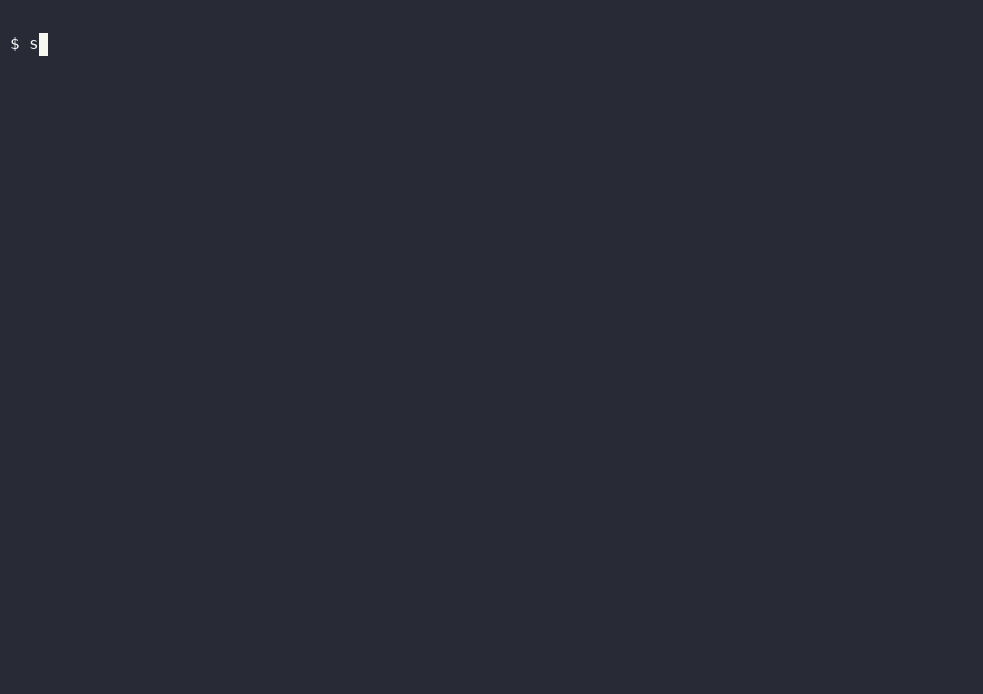

# scenario-browser

[](https://github.com/chiempt/scenario-browser/actions/workflows/ci.yml)
[](LICENSE)

Browser tests and automations as small **scenario files** (JSON or Markdown), organised in **projects**, with optional JavaScript where you need it. Plain Playwright + Chromium underneath. Experimental AI can draft scenarios and repair broken selectors.



> **Use it only on sites you own or are explicitly allowed to automate.**
> It does not solve captchas, evade bot detection, or spoof fingerprints, and will not accept contributions that do.

## Why

- **Readable by non-programmers.** A smoke test is five lines of Markdown, not a test framework setup.
- **Strict and honest.** Unknown keys are errors, failures name the step, and every failed step gets a screenshot and an HTML report.
- **Project-shaped.** Tags, shared variables, `.env`, setup/teardown and CI exit codes, so scenarios grow into a real suite.
- **Code when you need it.** `evaluate` and `script` steps drop into JavaScript; the rest stays declarative.
- **Small.** Two runtime dependencies (`playwright`, `zod`). No server, no account.

## Quickstart

```bash
npm install scenario-browser && npx cloakbrowser install   # or clone this repo: npm install && npm run browser:install
npx scenario-browser project init my-tests
npx scenario-browser project run --dir my-tests --tag smoke       # opens my-tests/reports/report.html afterwards
```

In a clone, replace `npx scenario-browser` with `node src/cli.ts` (Node 23.6+ runs the TypeScript directly). A terminal demo script is in `scripts/demo.sh`; the heal benchmark is in `docs/HEAL-BENCH.md` (`npm run bench:heal`).

## Scenarios

JSON (`scenario.schema.json` is included for editor autocomplete):

```json
{
  "name": "example.com page check",
  "tags": ["smoke"],
  "steps": [
    { "action": "goto", "url": "https://example.com" },
    { "action": "expect", "kind": "title", "value": "Example Domain" },
    { "action": "extract", "selector": "p", "as": "intro" }
  ]
}
```

Markdown, one step per line:

````markdown
# httpbin HTML page
tags: smoke

- goto https://httpbin.org/html
- waitFor h1
- expect text "Herman Melville"
- fill #q "text"            # unquoted = CSS/XPath/Playwright selector
- click "Login"             # quoted = visible text (text=Login)
- extract h1 as title       # later usable as {{title}}
- include ./login.md
- expect js "document.title.length > 0"

```js evaluate as headings
return document.querySelectorAll('h1').length;
```

```js
expect(vars.headings === 1, 'expected one h1');
```
````

Steps: `goto`, `click`, `fill`, `press`, `select`, `check`, `wait`, `waitFor`, `expect` (`text`, `visible`, `url`, `title`, `js`), `extract`, `screenshot`, `evaluate`, `script`, `include`, `if`, `repeat`, `forEach`. Every step accepts `note`, `continueOnError` (record as ignored, carry on) and `retry` (extra attempts, leaf steps). `if`/`repeat`/`forEach`/`retry`/`continueOnError` are JSON-only; Markdown covers the linear steps, `include`, and `js` blocks.

Selectors (details and the AI form in [docs/ai-context.md](docs/ai-context.md)):

| Form | Example |
|---|---|
| CSS (default) | `#go`, `css=.card > a` |
| XPath | `//button[@id="go"]`, `xpath=//a[1]` |
| Visible text | `text=Login` (Markdown: `click "Login"`) |
| Role + name | `role=button[name="Sign in"]` |
| Test id | `testid=login-btn` |
| Label / placeholder | `label=Email`, `placeholder=Search` |
| AI target | `ai=the Sign in button in the top right` |

In Markdown, quote a selector that has spaces: `click "role=button[name=\"Sign in\"]"`. URLs: absolute `http(s)`, or `/path` joined to `baseUrl` (scenario or project). Unknown keys are errors.

### Variables

`{{name}}` placeholders (dotted paths work: `{{user.id}}`). Precedence, low to high: project `vars` < setup output < scenario `vars` < `--var k=v`. `{{env.NAME}}` reads environment variables, with the project's `.env` file underneath (real environment wins, so CI secrets override local files). Unknown names are errors. Run reports list only variables a run created or changed, never the initial values or `env`.

### JavaScript steps

| Step | Runs | In scope |
|---|---|---|
| `evaluate` `{code, as}` | inside the page (`page.evaluate`) | `vars`; `return` a value, stored in `as` |
| `expect` `{kind:"js", value}` | inside the page, polled until truthy | `vars` |
| `script` `{code}` or `{file}` | in Node, async | `page`, `vars`, `env`, `expect`, `context` |

`expect(cond, msg)`, `expect.equal(a, b)`, `expect.contains(text, needle)` throw on failure. `script` can set `vars.x = ...` for later steps. `script file` and `include` paths resolve from the scenario file and may not leave the project directory.

> **A scenario is code.** `script` runs in Node with your user's rights, with no sandbox. Do not run scenarios or projects you did not write or review. See [SECURITY.md](SECURITY.md).

### Control flow

```json
{ "action": "forEach", "items": "names", "as": "name", "steps": [
    { "action": "fill", "selector": "#q", "value": "{{name}}" },
    { "action": "click", "selector": "text=Search", "retry": 2 },
    { "action": "if", "when": { "visible": ".empty" }, "then": [ { "action": "screenshot", "path": "empty-{{name}}.png" } ] }
] }
```

`forEach` takes an array or the name of an array variable (`<as>_index` holds the position). `repeat` takes `times` and an optional `as` counter. `if` takes `{"js": "..."}` or `{"visible": "..."}` with `then` and optional `else`. `include` runs another scenario in the same page, optionally with `vars`.

## Projects

A project is a directory with `scenario.project.json`:

```json
{
  "name": "my app",
  "baseUrl": "https://staging.example.com",
  "vars": { "user": "demo" },
  "envFile": ".env",
  "defaults": { "timeout": 10000, "headless": true, "launcher": "./launcher.mjs" },
  "scenarios": ["scenarios/**/*.{json,md}"],
  "setup": ["setup/login-check.json"],
  "teardown": [],
  "reportDir": "reports"
}
```

```bash
scenario-browser project init [dir]
scenario-browser project list --dir my-tests
scenario-browser project run --dir my-tests --tag smoke --grep login --var user=ann
```

`--tag` may repeat (any match). `setup` scenarios run first; a failure skips the tests, and values they `extract` flow into later scenarios as variables. `teardown` always runs. Each scenario gets a fresh browser context; share steps with `include`, not with browser state.

Exit codes: `0` all passed, `1` any scenario failed, `2` project/config error or nothing matched. The report (`reports/report.json`, `reports/report.html`, failure screenshots in `reports/shots/`) is overwritten each run. Two example projects are in `examples/projects/`.

### GitHub Actions

```yaml
name: browser-tests
on: [push, pull_request]
jobs:
  e2e:
    runs-on: ubuntu-latest
    steps:
      - uses: actions/checkout@v4
      - uses: actions/setup-node@v4
        with: { node-version: 24 }
      - run: npm ci
      - run: npx cloakbrowser install
      - run: npx scenario-browser project run --dir tests --tag smoke
        env:
          APP_PASSWORD: ${{ secrets.APP_PASSWORD }}   # read in scenarios as {{env.APP_PASSWORD}}
      - uses: actions/upload-artifact@v4
        if: always()
        with: { name: browser-report, path: tests/reports }
```

## CLI

| Command | What it does |
|---|---|
| `run <file> [--headed] [--var k=v] [--launcher mod] [--heal [--save-healed]] [--lock] [--no-ai]` | Run one scenario. Exit 0 pass, 1 fail. `--lock` saves selectors the AI found; `--no-ai` forbids AI calls. |
| `explain <file>` | Print a scenario as plain sentences. |
| `pick <url>` | Open the page, click an element, print XPath / CSS / text / role suggestions. |
| `validate <file\|dir>...` | Check scenarios and projects, including that `include`/`script file` targets exist. No browser. |
| `project init\|list\|run` | See Projects. |
| `portal [--port 7070] [--project dir]` | Local web UI. |
| `generate "description" [-o file.json]` | Experimental. AI drafts a scenario. |
| `schema [scenario\|project]` | Print a JSON Schema. |

## AI context (v0.2)

Give the AI your project's context and let it find selectors, or pick them yourself. Full guide with a `context.md` example: [docs/ai-context.md](docs/ai-context.md).

```bash
echo '"Giỏ hàng" is the cart icon in the header.' > context.md      # next to scenario.project.json
```
```markdown
- click ai="the cart icon"
```
```bash
export ANTHROPIC_API_KEY=...
scenario-browser run cart.md --lock       # AI finds it once, the selector is written into cart.md
scenario-browser run cart.md --no-ai      # from now on: locked selectors only, no AI, no key
scenario-browser explain cart.md          # read it back in plain sentences
scenario-browser pick https://your-site.example   # or click-to-copy locators yourself (also in the portal)
```

The model gets your context, the URL (no query), the title, your description and a reduced element list. Never input values, hidden inputs, cookies or screenshots. Without a key an `ai=` step stops the run with a clear error before the browser opens.

Status: the AI path is tested against a mocked API and real Chromium, not yet against the live Anthropic API; treat found selectors as drafts and review them (that is what `--lock` leaves in the file).

## AI steps (experimental)

`generate` and `--heal` are early and can be wrong. Treat their output as a draft you review. Set `ANTHROPIC_API_KEY` in your shell (read from the environment only, never stored or logged). Optional `SCENARIO_MODEL` overrides the model.

```bash
export ANTHROPIC_API_KEY=...
scenario-browser generate "open example.com and check the page title" -o my.json
scenario-browser run my.json --heal --save-healed
```

- `generate` asks the model for JSON, validates it against the schema, and retries once with the validation errors. Generated scenarios can contain JavaScript: read them before running.
- `--heal`: when a leaf step fails on a selector, a compact list of interactive elements from the current page (tags, ids, labels, trimmed text; never field values) is sent to the model, which proposes a replacement. The step is retried once and marked `healed` in the report. `--save-healed` writes repaired selectors back to a `.json` scenario.

Both send data to the Anthropic API (your description, or page structure). Do not use them on pages with data you may not share.

## Custom launcher

By default `run` starts plain Playwright Chromium. `--launcher <module>` (or `defaults.launcher` in a project) swaps that out: the module (path or package name) is imported dynamically and its default export (or named `launch`) is called with `{ headless }`. It must return a Playwright `BrowserContext` or `Page`; the runner closes it and its browser at the end. Works with `--heal`.

Plain Playwright with your own options (`my-launcher.mjs`):

```js
import { chromium } from 'playwright';

export default async ({ headless }) => {
  const browser = await chromium.launch({ headless });
  return browser.newContext({ viewport: { width: 1280, height: 800 }, locale: 'en-US' });
};
```

An already-installed Chrome via channel (no Chromium download needed):

```js
import { chromium } from 'playwright';

export default async ({ headless }) => {
  const browser = await chromium.launch({ channel: 'chrome', headless });
  return browser.newContext();
};
```

```bash
scenario-browser run examples/httpbin-html.md --launcher ./my-launcher.mjs --heal
```

The same acceptable-use rule applies to any launcher.

## Use as an MCP server

`scenario-browser-mcp` is a small stdio [MCP](https://modelcontextprotocol.io) server. It has three tools:

| Tool | What it does |
|---|---|
| `validate` | Check scenario text (JSON or Markdown). No browser. Returns `ok` or the errors. |
| `run` | Run a scenario (text, or a file path) headless and return the per-step report. Takes `vars`, `timeoutMs` (default 120000, max 600000) and `allowScript`. |
| `get_schema` | Return the scenario JSON Schema. |

Paths given to `run` must stay inside the server's working directory. JavaScript steps (`evaluate`, `script`, `expect` with `js`, `if` with `js`, including ones reached through `include`) are refused unless `allowScript` is `true`; it is off by default.

Claude Desktop (`claude_desktop_config.json`):

```json
{
  "mcpServers": {
    "scenario-browser": {
      "command": "npx",
      "args": ["-y", "-p", "scenario-browser", "scenario-browser-mcp"],
      "cwd": "/path/to/your/scenarios"
    }
  }
}
```

Claude Code:

```sh
claude mcp add scenario-browser -- npx -y -p scenario-browser scenario-browser-mcp
```

The browser is CloakBrowser (stealth Chromium, Playwright API): run `npx cloakbrowser install` once.

> **Safety.** A scenario is code. With `allowScript` on, it runs in Node with your user's rights and no sandbox, and even without it a scenario can open any URL your machine can reach. Only run scenarios you wrote or reviewed, and keep the server's working directory limited to the scenarios you mean to expose.

## Portal

```bash
scenario-browser portal --project my-tests      # http://127.0.0.1:7070
```

One page: paste or edit a scenario (JSON or Markdown), Validate, Run, read the log, Generate with AI (experimental). *Pick element* opens a page in a normal browser window; click an element to get XPath, CSS, text and role locators to copy or insert as a step. With a project it also lists scenarios and tags, runs by tag/grep, and shows the HTML report. It binds to `127.0.0.1`, rejects non-local `Host` headers and cross-origin POSTs, and has no authentication: do not expose it to a network. A scenario containing JavaScript shows a warning and asks for confirmation before it runs.

## Development

```bash
npm run check    # typecheck + build + tests + validate examples
```

Tests run against local fixture pages (real Chromium) and a mocked Anthropic API; no network or key needed. The example scenarios hit public sites (example.com, httpbin.org), which can change. See [CONTRIBUTING.md](CONTRIBUTING.md).

## Not done yet

Iframes, multi-tab, file upload/download steps, `if`/loops in Markdown, parallel runs, scheduled runs, run history in the portal, streaming logs, JUnit XML report, `--var` for non-string values.

## Maintained by PipeX

scenario-browser is maintained by [PipeX](https://www.pipex.pro/?utm_source=github&utm_medium=readme&utm_campaign=scenario-browser), a small company making Odoo modules and mobile apps.
Related open source from the same maintainer: [MCP Lite](https://github.com/chiempt/odoo-mcp-lite), a free read-only MCP server module for Odoo (Claude, ChatGPT, Cursor).

## License

MIT
